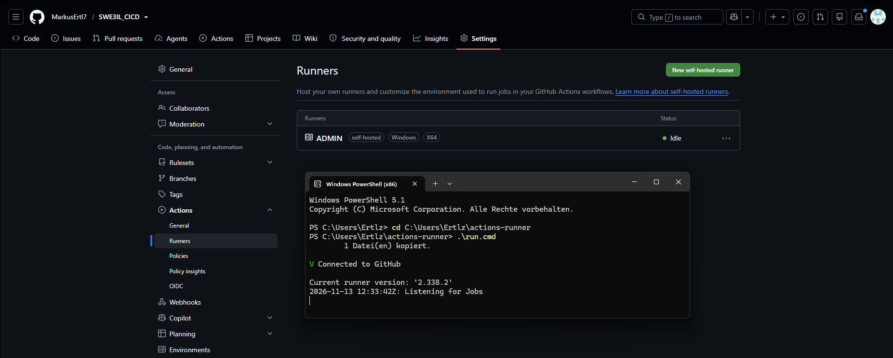

# CI/CD Pipeline with a GitHub Self-Hosted Runner

**Name:** <your name> · **Date:** <date>
**Repository:** https://github.com/MarkusErtl7/SWE3IL_CICD

## 1. Goal
Recreate the CI/CD pipeline from the lecture with GitHub Actions. All jobs run on a
self-hosted runner on my own Windows 11 machine instead of on GitHub-hosted runners.

## 2. Project overview
- **Application:** small Python/Flask web service (`/`, `/health`, `/add/<a>/<b>`)
- **Tests:** pytest (4 unit tests), linting with flake8
- **Container:** Dockerfile based on `python:3.11-slim`
- **Pipeline:** `.github/workflows/ci-cd.yml`, triggered on push/PR to `main` and manually

| Stage | Job | Steps |
|---|---|---|
| CI | Build & Test | checkout → create venv & install deps → flake8 → pytest |
| CD | Docker Build & Deploy | build image (tagged with commit SHA + `latest`) → remove old container → start new container on port 5000 → smoke test `/health` |

The deploy job depends on the CI job (`needs: build-and-test`) and only runs if all tests pass. Both jobs use `runs-on: self-hosted`.

## 3. Steps
1. Created a GitHub account and a public repository `SWE3IL_CICD`.
2. Wrote the Flask app, tests, Dockerfile and workflow file and pushed them to `main`.
3. Registered a self-hosted runner: *Settings → Actions → Runners → New self-hosted runner* (Windows x64), downloaded the runner package, ran `config.cmd` with the registration token and started it with `run.cmd`.
   The runner is started from PowerShell with `cd C:\Users\Ertlz\actions-runner` and `.\run.cmd`.
   It connects to GitHub and waits for jobs. In the repository under *Settings → Actions → Runners*
   the runner `ADMIN` (labels `self-hosted`, `Windows`, `X64`) is listed with status **Idle**.

   
   *Figure 1: Self-hosted runner registered in GitHub (Idle) and started locally with `run.cmd` ("Connected to GitHub", "Listening for Jobs").*
4. Started Docker Desktop and verified Python is on the PATH.
5. Triggered the pipeline (push / *Run workflow*).
   > 📸 Screenshot: runner terminal showing "Running job … Succeeded"
   > 📸 Screenshot: Actions tab with a green run (both jobs)
   > 📸 Screenshot: job log step "Show runner info" with my computer name
6. Verified the deployment: `docker ps` shows `cicd-demo-app`, http://localhost:5000 returns the JSON response.
   > 📸 Screenshot: browser / `docker ps`

## 4. Challenges and solutions
*(keep the ones that actually happened, add your own)*
- **First run failed at the first PowerShell step ("Process completed with exit code 1")** – the runner writes every `run:` step to a temporary `.ps1` file and runs it. Windows' default ExecutionPolicy (*Restricted*) blocks `.ps1` scripts, so the first run failed while the Node-based checkout step still worked. Fix: a custom shell in the workflow, `powershell -NoProfile -ExecutionPolicy Bypass -Command ". '{0}'"`, which only applies to the pipeline process and does not change the system-wide policy. The second run succeeded.
- **Job stuck on "Waiting for a runner"** – the runner was not running yet; starting `run.cmd` picked up the queued job.
- **Shell differences on Windows** – GitHub's examples use bash; on a Windows runner steps run in PowerShell, so the commands were written for PowerShell (`shell: powershell`, `.\.venv\Scripts\...`).
- **Docker daemon not reachable** – the deploy job failed with `failed to connect to the docker API` until Docker Desktop was started.
- **Runner as Windows service** – a service runs as `NETWORK SERVICE` and has no access to Docker Desktop, so the runner is started interactively with `run.cmd` under my user.
- **Replacing the running container** – a second deploy fails if a container with the same name already exists, so the pipeline removes the old container first.
- **Security** – self-hosted runners should only be used with private repos or trusted code, since a pull request from a fork could run code on my machine. The deploy job is therefore skipped for pull requests.

## 5. Result
The repository contains a successful pipeline run where both CI and CD jobs ran on my local machine (see screenshots).
